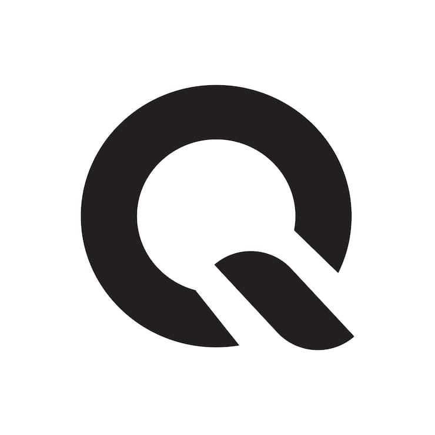

# ⚛️ QuantumBrowser

<p align="center">
  
</p>

<p align="center">
  <a href="https://github.com/TurkYoshi1905/quantum-browser/actions/workflows/windows-build.yml"></a>
  
  
  
  
</p>

> **WebView2 (Chromium) tabanlı, Rust çekirdekli, Arc tarzı ferah arayüze sahip, gizlilik saygılı masaüstü tarayıcı.**
> Sıfır telemetri · Yerleşik reklam/izleyici engelleyici · Şifreli şifre kasası · HTTPS zorunluluğu · Otomatik güncelleme

QuantumBrowser; arayüzü yeniden icat etmiyor — deneyimi düzeltiyor. Göz atıcı Chromium motoru (WebView2) sayesinde her site Chrome gibi açılırken, kabuk (sekmeler, adres çubuğu, yan şerit, kasa, indirme yöneticisi) tamamen bizim Rust + React yığınımızda yaşar.

---

## ✨ Özellikler (v0.0.4 — "Tam Donanımlı")

### Çekirdek
- **Dikey sekme şeridi** — sürükle-bırak ile yeniden sırala, renkli/daraltılabilir **sekme grupları**, pinli sekmeler, orta tuşla kapatma
- **`Ctrl+K` Komut Paleti** — tema, profil, sekmeler, iç sayfalar, güncelleme denetimi — hepsi tek tuştan (kabuk + iç sayfalarda)
- **Reklam & izleyici engelleyici** — ~110 bilinen ağ; sekme şeridi kalkan rozetinde engellenen sayacı görünür
- **HTTPS zorunluluğu** — `http://` adresleri engellenir; "Bu site güvenli değil" uyarı sayfası + tek seferlik "yine de devam et"
- **Çoklu profil + Gizli mod** — her profil ayrı WebView2 veri dizininde; gizli sekmeler diske hiçbir şey yazmaz

### Gizlilik & Güvenlik
- **Quantum Şifre Kasası** — `quantum://vault`; Argon2id ile anahtar türetme, AES-256-GCM ile şifre mühürleme; düz metin asla diske yazılmaz
- **Yer imleri & geçmiş** — FTS5 tam metin arama, gün bazlı geçmiş gruplama, toplu silme
- **Sıfır telemetri** — davranışlarınız cihazınızdan çıkmaz; veriler yalnızca `%LOCALAPPDATA%\com.quantum.browser` içinde (SQLite)

### Yaşam kalitesi
- **Otomatik güncelleme (v0.0.3+)** — uygulama açılışta GitHub Releases'ı denetler; dişli simgesinde mor rozet + **Ayarlar → Güncelleme → "Şimdi Güncelle"** tek dokunuşla imzalı installer'ı indirir ve üzerine kurar (eski sürüm silinmez)
- **Güncelleme ilerleme halkası, arka planda indirme, Ayarlar'da arama, Kurulumu Onar (`/S`), Güncelleme Geçmişi**
- **Premium NewTab** — canlı saat, selamlaşma, hızlı erişim ızgarası, gizlilik bildirimi
- **Klavye kısayolları** — `Ctrl+T` yeni sekme · `Ctrl+W` kapat · `Ctrl+Shift+T` son kapatılanı aç · `Ctrl+Tab` sıradaki · `Ctrl+1..9` sekmeye git · `Ctrl+Shift+N` gizli sekme · `Ctrl+B` yer imleri · `Ctrl+J` indirmeler · `Ctrl+K` komut paleti · `Ctrl+,` ayarlar · `Alt+←/→` geri/ileri
- **Tema** — Açık / Koyu / Sistem + **vurgu rengi** (mor · mavi · teal · amber · yeşil · kırmızı); tüm sayfalara canlı yansır

## 🧱 Teknoloji

| Katman | Teknoloji (lisans) |
|---|---|
| Kabuk (pencere + sekme webview'ları) | **Tauri v2** (`unstable`, NSIS) · **WebView2** (evergreen) |
| Çekirdek | **Rust 1.90+** — `rusqlite` (bundled **FTS5**), `argon2` (Argon2id), `aes-gcm` (AES-256-GCM), `chrono`, `uuid`, `rand`, `base64` |
| İletişim | Tauri IPC (invoke / event) |
| Arayüz | **React 18 + TypeScript 5 + Vite 5** · **Lucide** ikonlar (SVG, ISC) |
| Eklentiler | `tauri-plugin-updater` (minisign imzalı güncellemeler) |
| Kalıcılık | SQLite · `%LOCALAPPDATA%\com.quantum.browser\quantum.db` + `vault.db` (ayrı, şifreli) |

### Mimari

```
┌────────────────────────── 1 pencere ──────────────────────────┐
│  React kabuğu (titlebar + dikey şerit + adres çubuğu)         │
│  ┌──────────┬───────────────────────────────────────────────┐ │
│  │ Tab 1    │  Harici sayfalar (child webview)              │ │
│  │ (React)  │  ┌─ quantum://settings  (React, child wv)     │ │
│  │ Tab 2    │  ├─ quantum://vault     (React, child wv)     │ │
│  │ (React)  │  ├─ menu / toast / palette (child wv overlay) │ │
│  └──────────┴──┴────────────────────────────────────────────┘ │
└───────────────────────────────────────────────────────────────┘
  Rust: sekme motoru · reklam filtre · indirme · 
        IPC · SQLite (FTS5) · şifre kasası · updater
```

Child webview'lar z-order ile üst üste katmanlanır; kabuk klavyesi arka planda o sayfaya aittir. Her iç sayfa kendi `<html>` kökünde tema/akccent'i anlık uygular (`applyRootTheme`).

## 🚀 Geliştirme

**Önkoşullar**
- Windows 10/11 · [WebView2 Runtime](https://developer.microsoft.com/microsoft-edge/webview2/) (Win11'de hazır)
- [Rust](https://rustup.rs/) ≥ 1.90 + MSVC Build Tools
- Node.js ≥ 18 (CI: 22)

```powershell
npm ci                  # bağımlılıklar
npm run tauri dev       # geliştirme
npm run build           # sadece frontend (tsc + vite)
npm run tauri build     # release NSIS exe (QuantumBrowser_0.0.4_x64-setup.exe)
```

**CI (GitHub Actions):** `.github/workflows/windows-build.yml` — encoding lint → frontend → NSIS → SHA256SUMS + updater imzası (`TAURI_PRIVATE_KEY`) → `latest.json` + EXE/ZIP release. Yayınlar: [Releases](https://github.com/TurkYoshi1905/quantum-browser/releases).

> Cihazınızda **Smart App Control** açıksa (`os error 4551`) yerel Rust derlemesi engellenir; derleme CI'da yapılır.

## 🔐 Dürüstlük notu (bilinen sınırlar)

- **Chrome uzantıları yok** (WebView2) — yerleşik engelleme onun yerine geçer
- **Google / bazı OAuth akışları** `disallowed_useragent` dönebilir; OAuth Sistem tarayıcısına yönlendirme planlanıyor
- **DRM** içeriklerinde (Netflix/Spotify) oynatma farklılık gösterebilir
- **İmzasız derleme** (kod imzası yok) — Windows SmartScreen uyarısı görülebilir: **Daha fazla bilgi → Yine de çalıştır**. İmzalı **update paketleri** (minisign) her zaman doğrulanır; imzasız paket updater tarafından kurulmaz. Kod imzalama (Azure Trusted Signing / Signpath) v1.0 hedefi
- Tauri multiwebview API'si **`unstable`** — Tauri minor sürümde sabit

## 🗺️ Yol haritası

- **v0.0.5** — site iyileştirmeleri, daha sık sürümler
- **v1.0** — kod imzası (SmartScreen itibarı), Android port (TWA/WebView), opsiyonel telemetry **yok**
- **Bug edge-cases** — `rust.log` destekliysek tanılamayı araç olarak güçlendirme

## 📁 Yapı

```
src/                    React arayüz (kabuk)
  App.tsx               kabuk + tema senkronu + sessiz güncelleme + Ctrl+K
  main.tsx              route: shell / internal (#/newtab … #/vault) / popover / toast / palette
  pages/                NewTab, Settings/History/Bookmarks/Downloads/Profiles, Vault, Blocked, Toast, Palette, MenuPopup, Internal
  components/           Sidebar, AddressBar, TitleBar, Panels (Ayarlar & paneller), ErrorBoundary
  api.ts, types.ts, styles.css, utils/theme.ts
src-tauri/              Rust çekirdeği
  tabs.rs               sekme motoru + çocuk webview yerleşimi (relayout)
  blocker.rs            reklam/izleyici filtreleme (host listesi)
  vault.rs              Quantum Şifre Kasası (Argon2id + AES-256-GCM)
  db.rs                 SQLite şema + FTS5 + ayarlar seeds
  commands.rs           IPC komutları (sekmeler, vault, güncelleme, gruplar…)
  downloads.rs          indirme yöneticisi
  capabilities/         Tauri v2 izinleri
  icons/                uygulama ikonları
release-notes/          Sürüm notları (CI release gövdesi + site)
quantum-browser.png     Logo (pürüzsüz "Q" — kullanılıyor: app, web, site)
.github/workflows/      CI/CD: encoding lint → FE → NSIS → imza + SHA256 + release
```

## 🌐 Web

- **Site:** [quantumbrowser.vercel.app](https://quantumbrowser.vercel.app) — TR/EN, açık kaynak, ZIP veya EXE indirme, sürüm notları
- **Website reposu:** [TurkYoshi1905/quantum-browser-website](https://github.com/TurkYoshi1905/quantum-browser-website) (AGPL)
- **Sürüm notları:** [Releases](https://github.com/TurkYoshi1905/quantum-browser/releases) + sitede yayımlanır

## 🎨 İkonlar

Bütün ikonlar **Lucide** ([lucide.dev](https://lucide.dev), ISC) ile inline **SVG** olarak çizilir — emoji yok, metin ikonu var. Logo ve uygulama ikonları master PNG kaynağından üretilmiştir (root'ta `quantum-browser.png`).

## 🪪 Lisans

[**AGPL-3.0**](LICENSE) — kod dağıtırsanız veya ağ üzerinde servis ederseniz ayrıca kaynak paylaşmanız gerekir. Katkılarınızı PR olarak açabilirsiniz.
